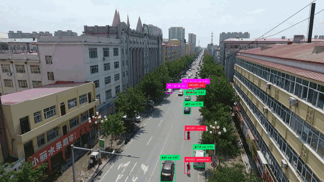
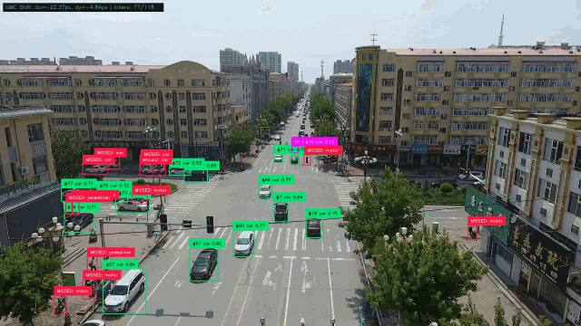
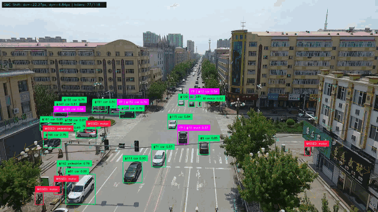

## Visual Comparison (`VisDrone2019-MOT-test-dev` — `uav0000249_00001_v`)

> **Legend:** 🟩 **Green** = True Positive (`TP`) | 🟪 **Magenta** = False Positive (`FP`) | 🟥 **Red** = Missed Ground Truth (`FN`) | 🟦 **Cyan Vectors** = Sparse Optical Flow GMC Inliers

| **1. Baseline: YOLOv8s (COCO) + Vanilla ByteTrack** | **2. YOLOv8s (Fine-Tuned, TRT INT8) + ByteTrack-GMC** |
| :---: | :---: |
|  |  |
| *High miss rate on top-down aerial targets (`32.65% MOTA`)* | *Balanced real-time CNN (`46.40% MOTA`, `3.01 ms` GPU)* |

| **3. YOLO11n (Fine-Tuned, TRT INT8) + ByteTrack-GMC** | **4. RT-DETR-L (Fine-Tuned, TRT FP16) + ByteTrack-GMC** |
| :---: | :---: |
|  |  |
| *Ultra-lightweight edge baseline (`33.24% MOTA`, `2.16 ms` GPU)* | *Highest tracking accuracy (`52.17% MOTA`, `7.47 ms` GPU)* |
