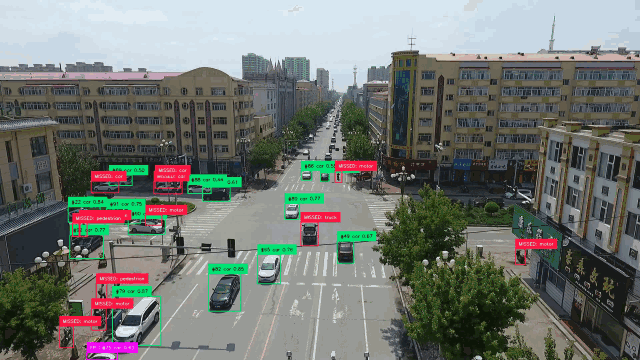
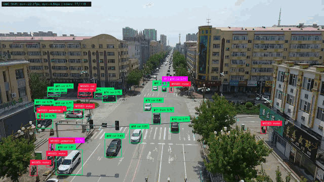
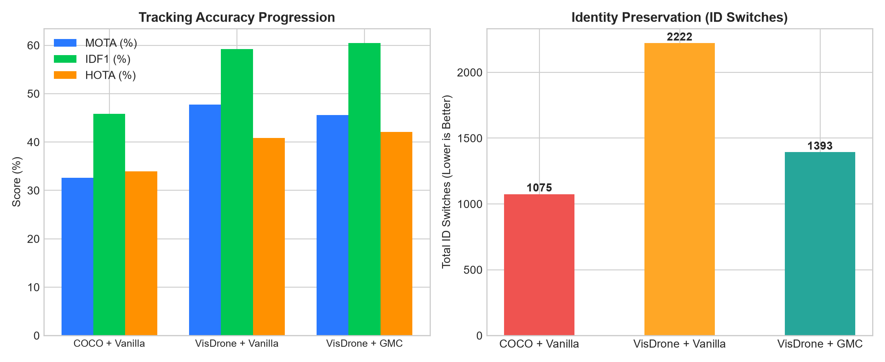
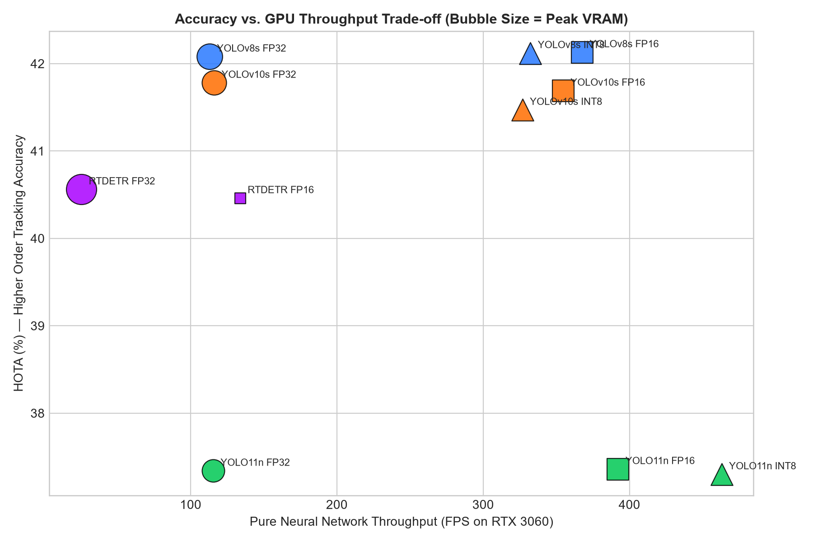
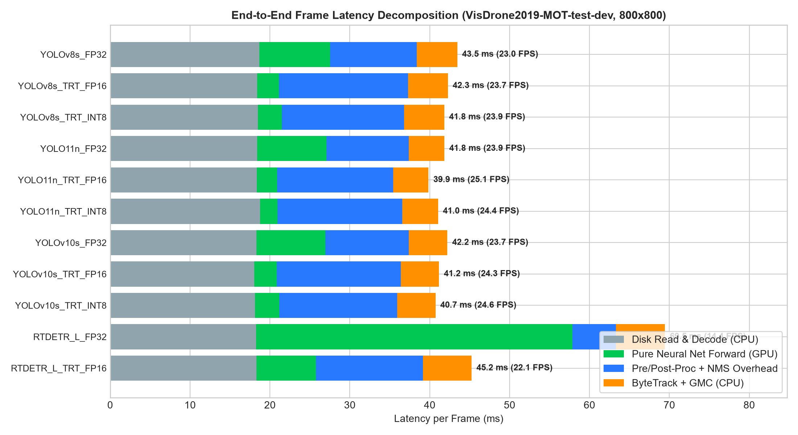

# Aerial Multi-Object Detection and Tracking Benchmark (VisDrone2019-MOT)

End-to-end computer vision benchmarking pipeline for UAV aerial surveillance, evaluating convolutional and transformer-based detectors (**YOLOv8s**, **YOLOv10s**, **YOLO11n**, **RT-DETR-L**) paired with **ByteTrack** and **Sparse Optical Flow Global Motion Compensation (GMC)** under **PyTorch FP32** and **NVIDIA TensorRT (FP16 / INT8)** quantization.

Evaluated across all 17 sequences of the **VisDrone2019-MOT-test-dev** benchmark at `800x800` input resolution on an **NVIDIA GeForce RTX 3060 Laptop GPU (6 GB VRAM)**.


---

## Visual Comparison (`VisDrone2019-MOT-test-dev` — `uav0000249_00001_v`)

> **Overlay Legend:** **Green** = True Positive (`TP`) | **Magenta** = False Positive (`FP`) | **Red** = Missed Ground Truth (`FN`) | **Cyan Vectors** = Sparse Optical Flow GMC Background Inliers

| **1. Baseline: YOLOv8s (COCO) + Vanilla ByteTrack** | **2. YOLOv8s (Fine-Tuned, TRT INT8) + ByteTrack-GMC** |
| :---: | :---: |
|  |  |
| **33.90% HOTA** \| 45.87% IDF1 \| 1,075 ID Sw \| 27.35 ms GPU | **42.12% HOTA** \| 61.13% IDF1 \| 1,514 ID Sw \| **3.01 ms GPU** |

| **3. YOLO11n (Fine-Tuned, TRT INT8) + ByteTrack-GMC** | **4. RT-DETR-L (Fine-Tuned, TRT FP16) + ByteTrack-GMC** |
| :---: | :---: |
|  |  |
| **37.30% HOTA** \| 48.66% IDF1 \| 782 ID Sw \| **2.16 ms GPU** | **40.46% HOTA** \| 61.95% IDF1 \| 6,632 ID Sw \| **7.47 ms GPU** |

*Note on visual grid selection: The 2x2 grid highlights the four distinct architectural and precision regimes (unadapted COCO baseline, top-HOTA CNN `YOLOv8s INT8`, ompact edge CNN `YOLO11n INT8`, and Vision Transformer `RT-DETR-L FP16`). The NMS-free `YOLOv10s` model exhibits visually similar tracking behavior to `YOLOv8s` (`41.47%` vs. `42.12%` HOTA in INT8) and is fully reported in the quantitative tables and Pareto plots below.*

---

## Executive Summary & Key Engineering Findings

* **Primary Metric Focus (HOTA vs. MOTA):** Because aerial tracking suffers from frequent camera motion and small-object occlusions, **HOTA** (*Higher Order Tracking Accuracy*) serves as the primary evaluation metric, balancing detection accuracy ($\text{DetA}$) with trajectory association stability ($\text{AssA}$).
* **Optimal Production Balance (`YOLOv8s TRT INT8 + GMC`):** Achieves the highest overall tracking consistency at **42.12% HOTA** (`42.13%` in FP16) and **46.40% MOTA**, compressing isolated neural network forward-pass latency by **2.94x** (`8.86 ms` to `3.01 ms`) with zero accuracy degradation.
* **NMS-Free Architecture Stability (`YOLOv10s`):** Eliminating Non-Maximum Suppression via dual-label assignments yields **41.78% HOTA** (`41.47%` in INT8) and the lowest ID switch count among medium-scale models (`1,188` ID switches in FP32 vs. `1,393` for YOLOv8s and `6,407` for RT-DETR-L), running at **3.06 ms** isolated GPU latency in INT8.
* **Domain Adaptation & Optical Flow GMC Impact:** Fine-tuning on VisDrone aerial imagery boosts YOLOv8s HOTA from **33.90%** to **40.80%** (`+6.90 pp`), while adding sparse Lucas-Kanade optical flow GMC with RANSAC affine estimation raises HOTA to **42.08%** (`+8.18 pp` total) and cuts identity switches by **37.3%** (`2,222` down to `1,393`).
* **CNN vs. Vision Transformer Quantization Behavior:** All three CNN architectures (`YOLOv8s`, `YOLOv10s`, `YOLO11n`) retain full HOTA accuracy under Post-Training Quantization (PTQ) to **INT8** (`2.16–3.06 ms` pure GPU latency). Conversely, **RT-DETR-L** achieves the highest raw detection recall (`52.23% MOTA`, `40.56% HOTA`) and accelerates **5.30x** in **TRT FP16** (`39.57 ms` to `7.47 ms`), but undergoes *PTQ Quantization Collapse* (`0.00%` at standard confidence threshold) in 8-bit integer precision due to activation outliers in self-attention and layer normalization blocks without Quantization-Aware Training (QAT).
* **End-to-End Bottleneck Analysis (Amdahl's Law):** Once TensorRT compresses GPU inference below `3.1 ms`, full pipeline throughput (`23.9–25.1 FPS`) is governed by synchronous disk frame decoding (`~18.3 ms`) and CPU optical-flow camera motion estimation (`~4.5–5.0 ms`).


---

## Quantitative Benchmarks & Analysis

All metrics are computed strictly according to the official VisDrone-MOT evaluation protocol across 7 target categories (`pedestrian`, `people`, `car`, `van`, `truck`, `bus`, `motor`), filtering out ignored regions (`score == 0` or `class == 0`).

### 1. Domain Adaptation & Camera Motion Compensation Ablation

Progressive evaluation isolating the impact of VisDrone fine-tuning and sparse optical-flow Global Motion Compensation (`GMC`) on `YOLOv8s` (`imgsz=800`, `FP32`):

| Experiment | Model | Tracker | HOTA (%) | IDF1 (%) | MOTA (%) | ID Switches | Pure GPU (ms) | Total Latency (ms) | FPS |
| :--- | :--- | :--- | :---: | :---: | :---: | :---: | :---: | :---: | :---: |
| `01_YOLOv8s_COCO_Vanilla` | `yolov8s.pt` | `bytetrack_vanilla` | 33.90 | 45.87 | 32.65 | 1,075 | 27.35 | 51.21 | 19.5 |
| `02_YOLOv8s_VisDrone_FP32_Vanilla` | `yolov8s_visdrone.pt` | `bytetrack_vanilla` | 40.80 | 59.24 | 47.72 | 2,222 | 8.79 | 39.05 | 25.6 |
| `03_YOLOv8s_VisDrone_FP32_GMC` | `yolov8s_visdrone.pt` | `bytetrack_gmc` | **42.08** | **60.44** | 45.60 | **1,393** | 8.80 | 42.28 | 23.7 |



### 2. Cross-Architecture Comparison (COCO Zero-Shot vs. VisDrone Fine-Tuned)

Comparison across four detector families paired with `ByteTrack-GMC` (`imgsz=800`, `FP32`):

| Experiment | Architecture | HOTA (%) | IDF1 (%) | MOTA (%) | ID Switches | Matched (TP) | False Pos | Pure GPU (ms) | Peak VRAM (MB) |
| :--- | :--- | :---: | :---: | :---: | :---: | :---: | :---: | :---: | :---: |
| `YOLOv8s_COCO_GMC` | CNN (Anchor-Free) | 34.62 | 45.93 | 30.86 | 642 | 95,388 | 4,928 | 8.91 | 265.5 |
| `YOLOv8s_VisDrone_FP32_GMC` | CNN (Anchor-Free) | **42.08** | 60.44 | 45.60 | 1,393 | 140,693 | 7,036 | 8.80 | 265.3 |
| `YOLO11n_COCO_GMC` | CNN (Edge Nano) | 30.10 | 38.23 | 24.24 | 481 | 75,128 | 4,092 | 8.78 | 230.2 |
| `YOLO11n_VisDrone_FP32_GMC` | CNN (Edge Nano) | 37.34 | 48.22 | 32.80 | **700** | 100,257 | **4,110** | **8.64** | **230.1** |
| `YOLOv10s_COCO_GMC` | CNN (NMS-Free) | 34.08 | 43.79 | 29.04 | 632 | 90,314 | 5,203 | 8.68 | 270.2 |
| `YOLOv10s_VisDrone_FP32_GMC` | CNN (NMS-Free) | 41.78 | 57.50 | 42.60 | 1,188 | 131,697 | 6,850 | 8.71 | 269.9 |
| `RTDETR_L_COCO_GMC` | Vision Transformer | 38.30 | 55.37 | 40.46 | 1,843 | 134,291 | 15,706 | 40.34 | 418.2 |
| `RTDETR_L_VisDrone_FP32_GMC` | Vision Transformer | 40.56 | **62.01** | **52.23** | 6,407 | **184,517** | 31,444 | 39.54 | 414.6 |

### 3. TensorRT Optimization & Hardware Latency Profiling

Post-training conversion from PyTorch `FP32` to TensorRT `FP16` and `INT8` engines (`workspace=4 GB`, calibrated on VisDrone validation imagery):

| Experiment | Precision | HOTA (%) | IDF1 (%) | MOTA (%) | ID Switches | Pure GPU (ms) | Infer Latency (ms) | Total Latency (ms) | FPS | Peak VRAM (MB) |
| :--- | :--- | :---: | :---: | :---: | :---: | :---: | :---: | :---: | :---: | :---: |
| `YOLOv8s_FP32` | PyTorch FP32 | 42.08 | 60.44 | 45.60 | 1,393 | 8.86 | 19.69 | 43.45 | 23.0 | 297.3 |
| `YOLOv8s_TRT_FP16` | TensorRT FP16 | **42.13** | 60.42 | 45.61 | 1,403 | 2.72 | 18.90 | 42.27 | 23.7 | 217.7 |
| `YOLOv8s_TRT_INT8` | TensorRT INT8 | 42.12 | 61.13 | 46.40 | 1,514 | 3.01 | 18.32 | 41.82 | 23.9 | 217.7 |
| `YOLO11n_FP32` | PyTorch FP32 | 37.34 | 48.22 | 32.80 | 700 | 8.67 | 18.98 | 41.84 | 23.9 | 230.1 |
| `YOLO11n_TRT_FP16` | TensorRT FP16 | 37.36 | 48.29 | 32.92 | **693** | 2.55 | **17.06** | **39.85** | **25.1** | 217.7 |
| `YOLO11n_TRT_INT8` | TensorRT INT8 | 37.30 | 48.66 | 33.24 | 782 | **2.16** | 17.82 | 41.05 | 24.4 | 217.7 |
| `YOLOv10s_FP32` | PyTorch FP32 | 41.78 | 57.50 | 42.60 | 1,188 | 8.62 | 19.07 | 42.21 | 23.7 | 269.9 |
| `YOLOv10s_TRT_FP16` | TensorRT FP16 | 41.69 | 57.41 | 42.55 | 1,252 | 2.82 | 18.35 | 41.17 | 24.3 | 217.7 |
| `YOLOv10s_TRT_INT8` | TensorRT INT8 | 41.47 | 57.41 | 42.70 | 1,277 | 3.06 | 17.82 | 40.72 | 24.6 | 217.7 |
| `RTDETR_L_FP32` | PyTorch FP32 | 40.56 | **62.01** | **52.23** | 6,407 | 39.57 | 45.01 | 69.46 | 14.4 | 414.6 |
| `RTDETR_L_TRT_FP16` | TensorRT FP16 | 40.46 | 61.95 | 52.17 | 6,632 | 7.47 | 20.86 | 45.25 | 22.1 | **51.0** |
| `RTDETR_L_TRT_INT8`* | TensorRT INT8 | 0.00 | 0.00 | 0.00 | 0 | 5.30 | 17.69 | 39.68 | 25.2 | 65.0 |

*\*`RTDETR_L_TRT_INT8` exhibits PTQ Quantization Collapse at the standard `0.35` confidence threshold: 8-bit uniform quantization in self-attention and deformable decoder layers compresses output logits below `0.15` due to activation outliers, requiring either `TRT_FP16` (`40.46% HOTA` @ `7.47 ms`) or Quantization-Aware Training (QAT).*





---

## System Architecture & Pipeline Design

* **GPU-Accelerated Pre/Post-Processing (`src/benchmark.py`):** Bypasses high-overhead Python wrapper loops by executing tensor normalization, bilinear letterboxing, and `torchvision.ops.batched_nms` directly on CUDA tensors, with unified decoding for both CNN `(1, 4+nc, N)` and RT-DETR `(1, 300, 6)` output layouts.
* **Global Motion Compensation (`src/trackers/cmc.py`):** Tracks Shi-Tomasi background keypoints via pyramidal Lucas-Kanade optical flow (`cv2.calcOpticalFlowPyrLK`) and estimates a 2D affine transformation (`cv2.estimateAffinePartial2D` with RANSAC) to project Kalman filter track predictions into the current camera frame before IoU matching.
* **Custom MOT Evaluation Engine (`src/metrics.py`):** Computes CLEAR MOT (`MOTA`, `MOTP`, `ID Switches`, `MT`, `ML`) and `IDF1` via `motmetrics` alongside a vectorized 19-threshold ($\alpha \in [0.05, 0.95]$) Hungarian-matching implementation of **HOTA**.
* **Diagnostic Visualizer (`src/visualizer.py`):** Renders frame-by-frame Hungarian IoU matching against ground truth (`TP` / `FP` / `FN`), object trajectories, and optical-flow camera motion vectors (`inliers` vs. `outliers`).

---

## Repository Structure

```text
VisDroneTrackingAndDetecting/
├── data/
│   └── VisDrone_UAV.yaml              # 7-class VisDrone dataset configuration
├── notebooks/
│   ├── 01_training.ipynb              # Fine-tuning workflow for YOLOv8s, YOLOv10s, YOLO11n, RT-DETR-L
│   └── 02_quantization.ipynb          # TensorRT FP16/INT8 export and calibration workflow
├── outputs/
│   ├── figures/                       # Summary plots (Latency Breakdown, Pareto Frontier, Ablation Impact)
│   ├── gifs/                          # Visual comparison demos embedded in README
│   ├── table1_tracker_ablation.csv    # Tracker and domain adaptation ablation results
│   ├── table2_architectures.csv       # Cross-architecture benchmark results
│   └── table3_tensorrt.csv            # TensorRT precision and latency profiling results
├── runs/uav_training/                 # Training curves, PR plots, confusion matrices, and hyperparams
├── src/
│   ├── export/
│   │   └── exporter.py                # ONNX and TensorRT engine builder
│   ├── trackers/
│   │   ├── base.py                    # Abstract tracker interface
│   │   ├── cmc.py                     # Sparse Optical Flow Global Motion Compensation
│   │   └── factory.py                 # ByteTrack & ByteTrack-GMC tracker factory
│   ├── training/
│   │   ├── prepare_dataset.py         # VisDrone-MOT to YOLO detection format converter
│   │   └── train.py                   # Training entrypoint
│   ├── benchmark.py                   # GPU inference loop, CUDA event profiler, and dataset runner
│   ├── metrics.py                     # HOTA, IDF1, and CLEAR MOT evaluation suite
│   ├── utils.py                       # Video assembly and I/O helpers
│   └── visualizer.py                  # GT-matched diagnostic video renderer
├── experiments.ipynb                  # Master evaluation and visualization notebook
└── requirements.txt                   # Locked Python dependencies
```

---

## Reproducibility & Quickstart

### 1. Environment Setup

```bash
git clone [https://github.com/Rich182182/VisDroneTrackingAndDetecting.git](https://github.com/Rich182182/VisDroneTrackingAndDetecting.git)
cd VisDroneTrackingAndDetecting
python -m venv .venv
.venv\Scripts\activate
pip install -r requirements.txt
```

### 2. Download Fine-Tuned Weights

Download the fine-tuned `.pt` checkpoints from the **[v1.0.0 GitHub Release](https://github.com/Rich182182/VisDroneTrackingAndDetecting/releases/tag/v1.0.0)** and place them into `weights/`:

* `weights/rtdetr_l_visdrone.pt`
* `weights/yolov8s_visdrone.pt`
* `weights/yolov10s_visdrone.pt`
* `weights/yolo11n_visdrone.pt`

### 3. Run Evaluation & Visualization

```python
from src.benchmark import run_dataset_experiment
from src.visualizer import run_visualization

tracker_params = {
    "lost_track_buffer": 120,
    "track_activation_threshold": 0.35,
    "minimum_consecutive_frames": 1,
    "minimum_iou_threshold": 0.05,
    "high_conf_det_threshold": 0.5,
}

# Evaluate across all 17 VisDrone2019-MOT-test-dev sequences
run_dataset_experiment(
    exp_name="YOLOv8s_VisDrone_FP32_GMC",
    model_path="weights/yolov8s_visdrone.pt",
    tracker_type="bytetrack_gmc",
    tracker_params=tracker_params,
    results_csv="outputs/table2_architectures.csv",
)

# Render diagnostic video with GT matching and optical-flow GMC overlay
run_visualization(
    model_path="weights/yolov8s_visdrone.pt",
    video_path="data/videos/uav0000249_00001_v.mp4",
    output_path="outputs/videos/demo_yolov8s_gmc.mp4",
    tracker_type="bytetrack_gmc",
    tracker_params=tracker_params,
    gt_path="data/VisDrone2019-MOT-test-dev/annotations/uav0000249_00001_v.txt",
    show_gmc_flow=True,
)
```
